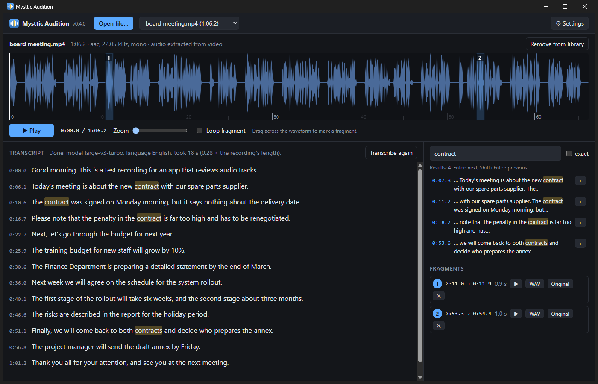

<p align="center">
  
</p>

<h1 align="center">Mysttic Audition</h1>

<p align="center">
  A local Windows app for reviewing recordings: a transcript with the timing of every word,
  word and phrase search, and comparing and trimming fragments. The audio is never altered,
  and recordings never leave your computer.
</p>

<p align="center">
  <a href="https://mysttic.github.io/Mysttic/mysttic-audition/"><b>Download</b></a>
  &nbsp;·&nbsp; <a href="CHANGELOG.md">Changelog</a>
  &nbsp;·&nbsp; <a href="VERSION.md">Version</a>
</p>

<p align="center">
  <i>Wersja polska: <a href="README.pl.md">README.pl.md</a></i>
</p>



## Features

- **Audio and video, no conversion.** MP3, WAV, M4A, FLAC, OGG, OPUS, WMA, MP4, MKV, MOV, AVI,
  WEBM and more. The app extracts the audio track from a video by itself.
- **Transcription on your computer.** Whisper large-v3-turbo with the timing of every word. Text
  appears as it is recognised, clicking a word plays the recording from there, and words
  recognised with low confidence are underlined.
- **Search that understands word forms.** Case, accents and punctuation don't matter. "contract"
  also finds "contracts", and in Polish "umowa" finds "umowy" and "umowie", while the phrase
  "kara umowna" also finds "karę umowną".
- **Fragments and A/B comparison.** Mark a fragment on the waveform or with "+" next to a search
  result, then switch between fragments with keys 1 to 9 and the loop.
- **Trimming without alteration.** WAV cut to the exact sample, or the original codec without
  re-encoding.
- **Behaves like any Windows program.** Its own window and a single instance; closing the window
  ends everything, including transcription and the memory used by the model.
- **English or Polish, whatever the recording.** The interface is in English by default, with
  Polish in Settings. The language of a recording is chosen for each file before it is
  transcribed, independently of the interface language.
- **Updates.** Once a day, verified with SHA-256, installed at the next start.

## Installation

Requirements:

- Windows 10 or 11 with Microsoft Edge WebView2 (built into Windows 11);
- Python 3.10 or newer from [python.org](https://www.python.org/downloads/), including the
  "py launcher", which makes double-clicking `.pyw` files work;
- about 2 GB of disk space for the dependencies and the default model;
- an internet connection on the first start (dependencies) and for the first transcription
  (the model, 1.6 GB).

Steps:

1. Download `mysttic-audition-<version>-windows.zip` from the
   [project page](https://mysttic.github.io/Mysttic/mysttic-audition/) and unpack it anywhere.
2. Double-click `mysttic-audition.pyw`. The first start opens a console that installs the
   dependencies (a few minutes), and then the app starts by itself.

## Usage

| Action | How |
|---|---|
| Open a file | "Open file…" or drag a file into the window, then choose the recording language and "Transcribe" |
| Play from a word | click a word or a timestamp in the transcript |
| Play and pause | Space |
| Skip | left and right arrows, 2 s at a time |
| Search | the "Search for a word or phrase" box; Enter and Shift+Enter move between results |
| Fragment | drag across the waveform, or "+" next to a result |
| A/B comparison | keys 1 to 9 play the fragments, L turns the loop on |
| Export | "WAV" or "Original" next to a fragment, then the "Save As" dialog |
| Settings: interface language, defaults, updates, data | the "Settings" button in the top right corner, or Ctrl+, |
| Transcribe again in another language or with another model | "Transcribe again" above the text |

Export:

- **WAV**: cut to the exact sample. The samples are identical to the original (for lossy
  formats: to the decoded original).
- **Original**: the original codec's frames without re-encoding, so the data is untouched. The
  cut edges are accurate to a codec frame, about 20 to 30 ms; for uncompressed WAV the cut is
  exact to the sample.

Closing the window ends the whole app. An interrupted transcription goes back to the queue at
the next start. Starting the app again while it is running does not open a second copy; it
brings the existing window back.

## Languages

The interface language and the recording language are separate. The interface is in English
by default; Polish is in Settings, General section, and the change applies at once, without a
restart.

The recording language is chosen for each file, in the dialog that opens when you add it and
before anything is sent for transcription; "Transcribe again" opens the same dialog. "Detect
automatically" lets Whisper recognise the language from the first 30 seconds of speech; choose
the language yourself if a recording starts with music, silence or a different language. The
Transcription section of Settings only sets what the dialog preselects.

## Models

| Model | Notes |
|---|---|
| large-v3-turbo | default; on a Ryzen 7 8845HS transcription takes about 0.25 of the recording's length |
| small | several times faster, clearly weaker for Polish |
| medium | in between |
| large-v3 | the most accurate, several times slower than turbo |

Models are downloaded to `models/` on first use, and transcription runs on the CPU. Whisper
writes numbers as digits ("10%" rather than "ten percent"), so search for numbers using digits.

## Updates

- Once a day (an option in Settings, Updates section, on by default) the app asks GitHub's
  public API for the releases in [Mysttic/Mysttic](https://github.com/Mysttic/Mysttic/releases),
  which the project page uses as well. No token and no data about the user or the computer.
- It downloads a newer version only from `github.com/Mysttic/Mysttic/releases/download/`,
  checks its size and SHA-256 checksum, unpacks it to `data/update/` and waits.
- The launcher installs it at the next start, or right away with the "Restart and install"
  button. Only the program files are replaced: `data/`, `models/` and `.venv/` stay. When a new
  version changes the dependencies, the launcher installs them by itself.
- A network error breaks nothing; the next attempt is an hour later.

## Data and privacy

- `data/<id>/`: a copy of the original audio track (without the picture), a FLAC preview, the
  waveform and the transcript. The uploaded copy of the file is deleted once the audio is
  extracted, and the original stays where it was. "Remove from library" deletes the app's data
  for that file.
- `data/ustawienia.json` holds the settings (interface language, default recording language and
  model, text scrolling), `data/aktualizacje.json` the update settings, and `data/app.log` the log. The
  Data section of Settings shows how much space the library and the models take and opens their
  folders.
- The app connects to the internet only for the dependencies, the models and the release
  information.

## For developers

| Path | Role |
|---|---|
| `mysttic-audition.pyw` | launcher: dependencies, installing updates, starting without a console |
| `app.py` | server (FastAPI), audio (ffmpeg, PyAV), transcription, window (pywebview) |
| `updates.py` | updates following the hub contract, standard library only |
| `static/` | interface (HTML, CSS, JS, translations in `i18n/`, wavesurfer.js in `vendor/`) and icon |
| `instaluj.bat` | creates `.venv` and installs `requirements.txt` |
| `tools/pakiet.py` | release package with a checksum file |
| `tools/make_icons.py` | the icon from a single description: `brand/icon.svg`, `static/icon.ico`, `static/icon.png` |
| `tests/` | tests of updates and translations |
| `.github/workflows/` | `testy.yml` and `wydanie.yml` |
| `spike/` | experiment: Whisper in the browser (WebGPU) compared with faster-whisper |

The server without a window, at http://127.0.0.1:8791 (another port: `AUDITION_PORT`):

```bash
.venv/Scripts/python.exe app.py --server
```

Tests (standard library only):

```bash
python -m unittest discover -s tests -v
```

The icon after changing its description in `tools/make_icons.py` (needs Pillow from
`requirements-dev.txt`):

```bash
.venv/Scripts/python.exe tools/make_icons.py
```

### Translations

Interface texts are in `static/i18n/en.json` and `static/i18n/pl.json`. The HTML marks
elements with `data-i18n` (text), `data-i18n-title` and `data-i18n-placeholder`, and `app.js`
uses `t('key', {param})`; an entry with plural forms is an object keyed by
[`Intl.PluralRules`](https://developer.mozilla.org/docs/Web/JavaScript/Reference/Global_Objects/Intl/PluralRules)
categories. The server reports errors as codes (`{"code": "file_not_found"}`), which the
interface translates with the `error.*` keys. `tests/test_i18n.py` checks that both languages
have the same keys, placeholders and plural forms, and that every key and error code used in
the code has a translation.

### Releasing a new version

1. Raise the number in [VERSION.md](VERSION.md).
2. Add a `## [X.Y.Z] - YYYY-MM-DD` section to [CHANGELOG.md](CHANGELOG.md).
3. Merge the changes into `main`. The [wydanie.yml](.github/workflows/wydanie.yml) workflow runs
   the tests, builds the package with checksums, publishes the `vX.Y.Z` release and copies both
   files to the hub as `mysttic-audition-vX.Y.Z`. From then on, the project page and the update
   check in the app can see it.

The repository needs a `HUB_TOKEN` secret, set once in Settings, Secrets and variables, Actions:
a fine-grained personal access token, owner `Mysttic`, access to `Mysttic/Mysttic` only, with
Contents: Read and write. The hub contract is described in
[RELEASES.md](https://github.com/Mysttic/Mysttic/blob/master/RELEASES.md).

## Third-party libraries

faster-whisper and CTranslate2 (MIT), the Whisper models (MIT), FastAPI (MIT), Uvicorn
(BSD-3-Clause), pywebview (BSD-3-Clause), wavesurfer.js (BSD-3-Clause, license in
`static/vendor/`), PyAV (BSD-3-Clause), NumPy (BSD-3-Clause) and imageio-ffmpeg (BSD-2-Clause)
with an FFmpeg build under the GPL. FFmpeg is installed through pip and is not part of the
release package.
