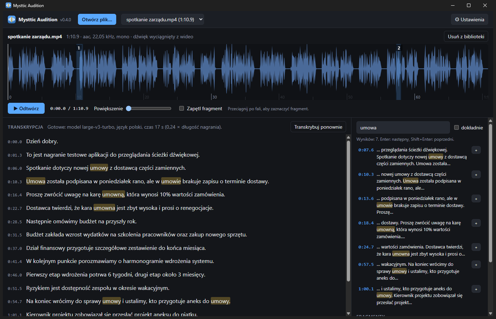

<p align="center">
  
</p>

<h1 align="center">Mysttic Audition</h1>

<p align="center">
  Lokalna aplikacja Windows do przeglądania nagrań: transkrypcja z czasem każdego słowa,
  wyszukiwanie słów i fraz, porównywanie i przycinanie fragmentów. Dźwięk nie jest w żaden
  sposób modyfikowany, a nagrania nie opuszczają komputera.
</p>

<p align="center">
  <a href="https://github.com/Mysttic/mysttic-audition/releases/latest"><b>Pobierz</b></a>
  &nbsp;·&nbsp; <a href="CHANGELOG.md">Historia zmian</a> (po angielsku)
  &nbsp;·&nbsp; <a href="VERSION.md">Numer wersji</a>
</p>

<p align="center">
  <i>English version: <a href="README.md">README.md</a></i>
</p>

> **Projekt nie jest już aktywnie rozwijany.** Aplikacja działa w obecnej postaci, a jej wydania
> zostają dostępne na stronie [Releases](https://github.com/Mysttic/mysttic-audition/releases)
> tego repozytorium.



## Co potrafi

Otwierasz plik audio albo wideo, czytasz tekst w trakcie transkrypcji, szukasz słowa lub frazy
i odtwarzasz nagranie dokładnie od tego miejsca. To narzędzie do przeglądania, nie edytor:
pokazuje, znajduje, porównuje i przycina, a każdą próbkę nagrania zostawia taką, jaka była.

- **Audio i wideo bez konwersji.** MP3, WAV, M4A, FLAC, OGG, OPUS, WMA, MP4, MKV, MOV, AVI,
  WEBM i inne. Ścieżkę dźwiękową z wideo aplikacja wyciąga sama.
- **Transkrypcja na tym komputerze.** Whisper large-v3-turbo z czasem każdego słowa. Tekst
  pojawia się na bieżąco, kliknięcie słowa odtwarza nagranie od tego miejsca, a słowa
  rozpoznane z niską pewnością są podkreślone.
- **Szukanie z odmianą.** Wielkość liter, ogonki i interpunkcja nie mają znaczenia. „umowa”
  znajdzie „umowy” i „umowie”, a fraza „kara umowna” także „karę umowną”.
- **Fragmenty i porównanie A/B.** Zaznaczenie na fali albo „+” przy wyniku wyszukiwania,
  klawisze 1 do 9 i pętla.
- **Przycinanie bez modyfikacji.** WAV wycięty co do próbki albo oryginalny kodek bez
  ponownego kodowania.
- **Program jak każdy inny w Windows.** Własne okno i jedna kopia; zamknięcie okna kończy
  wszystko, łącznie z transkrypcją i pamięcią zajętą przez model.
- **Po polsku albo po angielsku, niezależnie od nagrań.** Domyślnie interfejs jest po
  angielsku, polski włączysz w ustawieniach. Język nagrania wybierasz dla każdego pliku przed
  transkrypcją, bez względu na język interfejsu.
- **Aktualizacje.** Raz na dobę z wydań tego repozytorium, ze sprawdzeniem sumy SHA-256,
  instalacja przy następnym starcie albo jednym kliknięciem. Pliki, modele i ustawienia zostają
  nietknięte.

## Instalacja

Wymagania:

- 64-bitowy Windows 10 lub 11 z Microsoft Edge WebView2, który rysuje okno aplikacji (w Windows
  11 jest w systemie);
- Python 3.10 lub nowszy z [python.org](https://www.python.org/downloads/), razem z „py
  launcher”, dzięki któremu działa dwuklik w pliki `.pyw`;
- około 2 GB miejsca na zależności i domyślny model;
- internet przy pierwszym uruchomieniu (zależności) i przy pierwszej transkrypcji (model, 1,6 GB).
  Potem aplikacja działa bez internetu, poza codziennym sprawdzaniem aktualizacji.

Kroki:

1. Pobierz `mysttic-audition-<wersja>-windows.zip` z
   [najnowszego wydania](https://github.com/Mysttic/mysttic-audition/releases/latest) i rozpakuj
   w wybranym miejscu. W wydaniu jest też `mysttic-audition-<wersja>-checksums.txt` z sumą
   SHA-256 archiwum.
2. Dwuklik `mysttic-audition.pyw`. Pierwszy start otwiera konsolę z instalacją zależności we
   własnym folderze aplikacji (`.venv`, kilka minut), potem aplikacja uruchamia się sama.
3. Interfejs jest po angielsku. Polski: Settings, sekcja General, Interface language: Polski.

Masz wersję 0.4.0 lub starszą? Takie kopie nie widzą w aplikacji nowszych wydań, więc nową wersję
trzeba raz zainstalować ręcznie, zob. [Aktualizacje](#aktualizacje).

## Obsługa

| Czynność | Jak |
|---|---|
| Otwarcie pliku | „Otwórz plik…” albo przeciągnięcie pliku do okna, potem wybór języka nagrania i „Transkrybuj” |
| Odtwarzanie od słowa | kliknięcie słowa albo znacznika czasu w transkrypcji |
| Odtwarzanie i pauza | Spacja |
| Przewijanie | strzałki w lewo i w prawo, o 2 s |
| Szukanie | pole „Szukaj słowa lub frazy”; Enter i Shift+Enter przechodzą między wynikami |
| Fragment | przeciągnięcie po fali albo „+” przy wyniku |
| Porównanie A/B | klawisze 1 do 9 odtwarzają fragmenty, L włącza pętlę |
| Eksport | „WAV” albo „Oryginał” przy fragmencie, potem okno „Zapisz jako” |
| Ustawienia: język interfejsu, wartości domyślne, aktualizacje, dane | przycisk „Ustawienia” w prawym górnym rogu albo Ctrl+, |
| Ponowna transkrypcja w innym języku lub innym modelem | „Transkrybuj ponownie” nad tekstem |

Eksport:

- **WAV**: cięcie co do próbki. Próbki są identyczne z oryginałem (dla formatów stratnych: ze
  zdekodowanym oryginałem).
- **Oryginał**: ramki oryginalnego kodeka bez ponownego kodowania, więc dane są nietknięte.
  Granice cięcia mają dokładność ramki kodeka, około 20 do 30 ms; dla nieskompresowanego WAV
  cięcie jest co do próbki.

Zamknięcie okna kończy całą aplikację. Przerwana transkrypcja wraca do kolejki przy następnym
starcie. Ponowne uruchomienie przy otwartej aplikacji nie otwiera drugiej kopii, tylko
przywraca istniejące okno.

## Języki

Język interfejsu i język nagrania to dwie osobne rzeczy. Domyślnie interfejs jest po
angielsku; polski jest w ustawieniach, w sekcji Ogólne (General), i działa od razu, bez
ponownego uruchamiania.

Transkrypcja działa po polsku, angielsku, niemiecku i w innych językach, które zna Whisper:
okienko podsuwa dziesięć popularnych, a „wykryj automatycznie” obejmuje pozostałe.

Język nagrania wybierasz dla każdego pliku w okienku, które pokazuje się przy jego dodawaniu,
zanim cokolwiek trafi do transkrypcji; „Transkrybuj ponownie” otwiera to samo okienko. Opcja
„wykryj automatycznie” zostawia rozpoznanie języka Whisperowi, który ocenia pierwsze 30 sekund
mowy; wybierz język ręcznie, gdy nagranie zaczyna się muzyką, ciszą albo innym językiem.
Sekcja Transkrypcja w ustawieniach decyduje tylko o tym, co okienko podsuwa na start.

## Modele

| Model | Uwagi |
|---|---|
| large-v3-turbo | domyślny; na Ryzen 7 8845HS transkrypcja trwa ok. 0,25 długości nagrania |
| small | kilka razy szybszy, wyraźnie słabszy dla polskiego |
| medium | pośredni |
| large-v3 | najdokładniejszy, kilka razy wolniejszy od turbo |

Modele pobierają się do `models/` przy pierwszym użyciu, a transkrypcja działa na procesorze.
Whisper zapisuje liczby cyframi („10%” zamiast „dziesięć procent”), więc liczb szukaj cyframi.

## Aktualizacje

- Raz na dobę (opcja w ustawieniach, sekcja Aktualizacje, domyślnie włączona) aplikacja pyta
  publiczne API GitHuba o [wydania tego repozytorium](https://github.com/Mysttic/mysttic-audition/releases).
  Bez tokenu i bez danych o użytkowniku czy komputerze.
- Nowszą wersję pobiera wyłącznie spod `github.com/Mysttic/mysttic-audition/releases/download/`,
  po HTTPS, sprawdza rozmiar i sumę SHA-256, rozpakowuje do `data/update/` i czeka. Archiwum ze
  ścieżką spoza plików programu, na przykład do `data/` albo `models/`, jest odrzucane w całości.
- Instaluje ją launcher przy następnym uruchomieniu albo od razu przycisk „Uruchom ponownie
  i zainstaluj”. Podmieniane są tylko pliki programu: `data/`, `models/` i `.venv/` zostają.
  Gdy nowa wersja zmienia zależności, launcher sam je doinstaluje.
- Błąd sieci niczego nie psuje; kolejna próba za godzinę.

Kopie do 0.4.0 szukają aktualizacji w osobnym hubie wydań, gdzie ostatnim wydaniem zostaje
0.4.0, więc nigdy nie zaproponują 0.5.0 ani nowszej. Nową wersję zainstaluj raz ręcznie: zamknij
aplikację, pobierz `mysttic-audition-<wersja>-windows.zip` z
[najnowszego wydania](https://github.com/Mysttic/mysttic-audition/releases/latest) i skopiuj
zawartość jego folderu `mysttic-audition` do folderu aplikacji, zastępując pliki. `data/`,
`models/` i `.venv/` nie ma w archiwum, więc biblioteka, modele i ustawienia zostają. Od tej
pory aplikacja aktualizuje się sama z tego repozytorium.

## Dane i prywatność

Bez konta, bez telemetrii i bez żadnego serwera autora po drodze. Odczyt, transkrypcja
i przycinanie odbywają się na tym komputerze.

- `data/<id>/`: kopia oryginalnej ścieżki dźwiękowej (bez obrazu), podgląd FLAC, przebieg fali
  i transkrypcja. Przesłana kopia pliku jest usuwana po wyciągnięciu dźwięku, oryginał zostaje
  tam, gdzie był. „Usuń z biblioteki” kasuje dane aplikacji dla danego pliku.
- `data/ustawienia.json` to ustawienia (język interfejsu, domyślny język nagrań i model,
  przewijanie tekstu), `data/aktualizacje.json` ustawienia aktualizacji, a `data/app.log` dziennik. Sekcja
  Dane w ustawieniach pokazuje, ile zajmują biblioteka i modele, i otwiera ich foldery.
- Z internetem aplikacja łączy się tylko w trzech sprawach: pakiety Pythona przy pierwszym
  uruchomieniu, model mowy przy pierwszej transkrypcji i raz na dobę lista wydań z API GitHuba,
  bez tokenu i bez danych o Tobie czy komputerze. Sprawdzanie aktualizacji można wyłączyć
  w ustawieniach, w sekcji Aktualizacje.

## Dla deweloperów

| Ścieżka | Rola |
|---|---|
| `mysttic-audition.pyw` | launcher: zależności, instalacja aktualizacji, start bez konsoli |
| `app.py` | serwer (FastAPI), dźwięk (ffmpeg, PyAV), transkrypcja, okno (pywebview) |
| `updates.py` | aktualizacje z GitHub Releases tego repozytorium, tylko biblioteka standardowa |
| `static/` | interfejs (HTML, CSS, JS, tłumaczenia w `i18n/`, wavesurfer.js w `vendor/`) i ikona |
| `instaluj.bat` | tworzy `.venv` i instaluje `requirements.txt` |
| `tools/pakiet.py` | paczka wydania z plikiem sum |
| `tools/make_icons.py` | ikona z jednego opisu: `brand/icon.svg`, `static/icon.ico`, `static/icon.png` |
| `tests/` | testy aktualizacji i tłumaczeń |
| `.github/workflows/` | `testy.yml` i `wydanie.yml` |
| `spike/` | eksperyment: Whisper w przeglądarce (WebGPU) porównany z faster-whisper |

Serwer bez okna pod http://127.0.0.1:8791 (inny port: `AUDITION_PORT`):

```bash
.venv/Scripts/python.exe app.py --server
```

Testy (sama biblioteka standardowa):

```bash
python -m unittest discover -s tests -v
```

Ikona po zmianie opisu w `tools/make_icons.py` (potrzebuje Pillow z `requirements-dev.txt`):

```bash
.venv/Scripts/python.exe tools/make_icons.py
```

### Tłumaczenia

Teksty interfejsu są w `static/i18n/en.json` i `static/i18n/pl.json`. HTML oznacza elementy
atrybutami `data-i18n` (treść), `data-i18n-title` i `data-i18n-placeholder`, a `app.js` używa
`t('klucz', {parametr})`; wpis z formami liczby mnogiej to obiekt z kategoriami
[`Intl.PluralRules`](https://developer.mozilla.org/docs/Web/JavaScript/Reference/Global_Objects/Intl/PluralRules).
Serwer zgłasza błędy kodami (`{"code": "file_not_found"}`), które interfejs tłumaczy kluczami
`error.*`. `tests/test_i18n.py` sprawdza, że oba języki mają te same klucze, parametry i formy
liczby mnogiej oraz że każdy klucz i kod błędu użyty w kodzie ma tłumaczenie.

### Wydanie nowej wersji

1. Podnieś numer w [VERSION.md](VERSION.md).
2. Dopisz sekcję `## [X.Y.Z] - RRRR-MM-DD` w [CHANGELOG.md](CHANGELOG.md) (po angielsku).
3. Scal zmiany do `main`. Workflow [wydanie.yml](.github/workflows/wydanie.yml) uruchomi testy,
   zbuduje paczkę z sumami i opublikuje wydanie `vX.Y.Z` w tym repozytorium. Od tej chwili widzi
   je aktualizacja w aplikacji.

## Biblioteki zewnętrzne

faster-whisper i CTranslate2 (MIT), modele Whisper (MIT), FastAPI (MIT), Uvicorn
(BSD-3-Clause), pywebview (BSD-3-Clause), wavesurfer.js (BSD-3-Clause, licencja w
`static/vendor/`), PyAV (BSD-3-Clause), NumPy (BSD-3-Clause) oraz imageio-ffmpeg (BSD-2-Clause)
z kompilacją FFmpeg na licencji GPL. FFmpeg instaluje się przez pip i nie jest częścią paczki
wydania.
